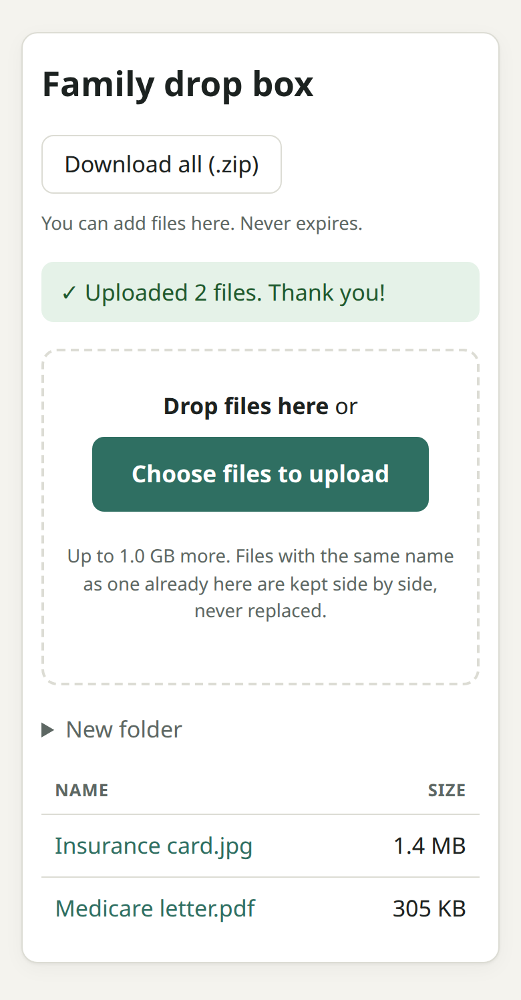
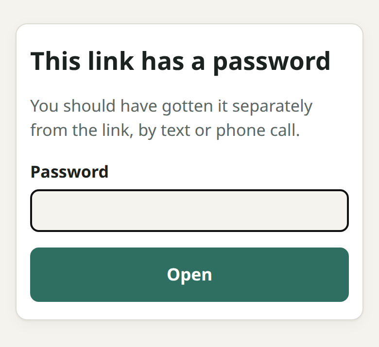
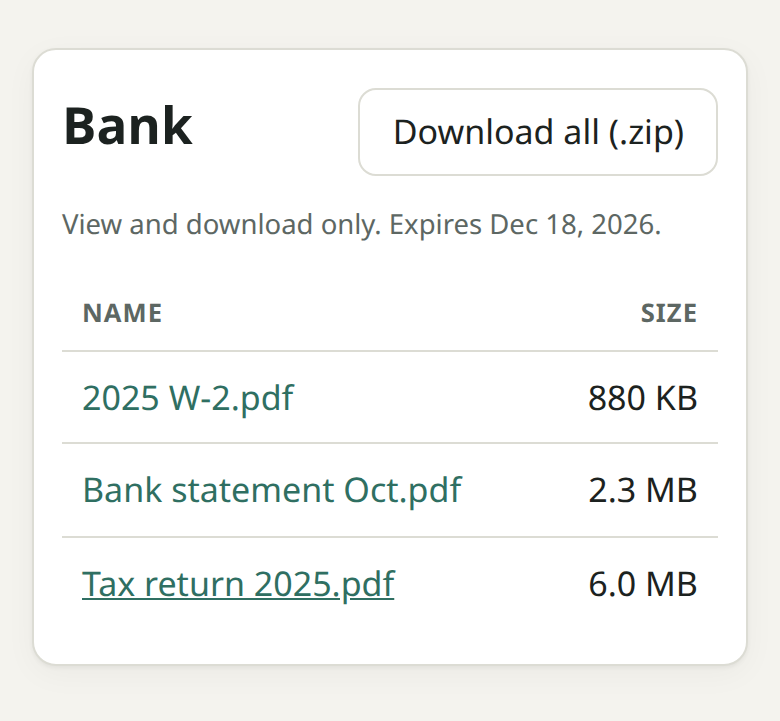
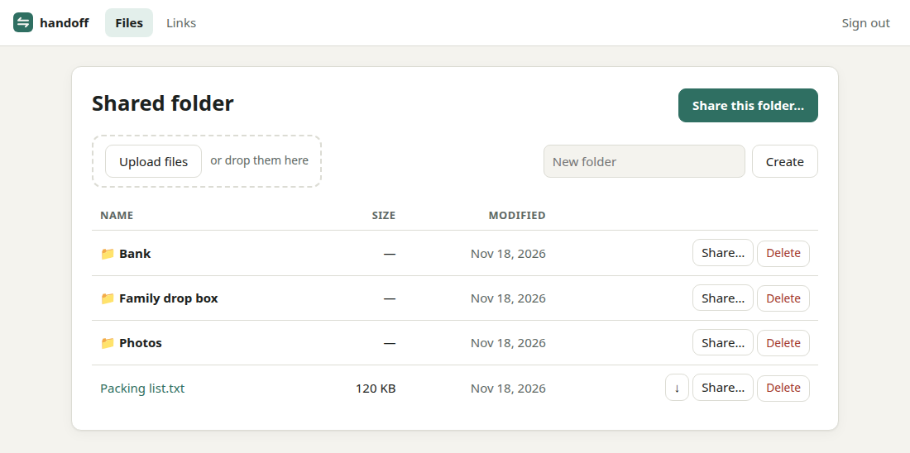
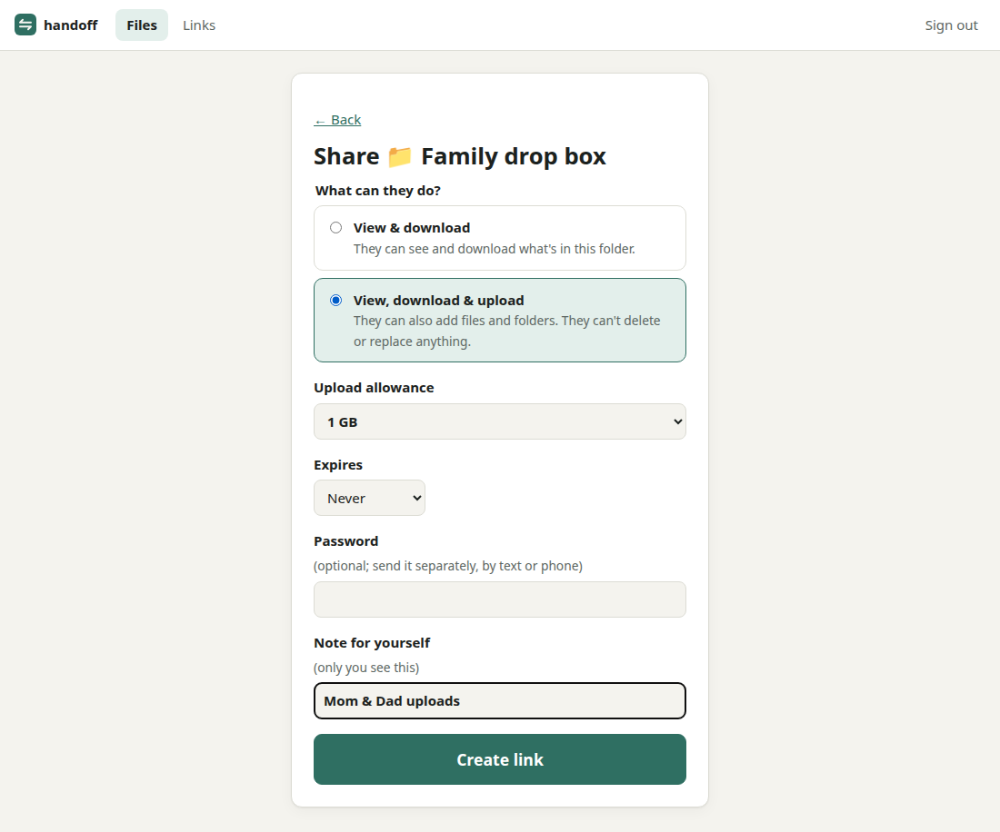
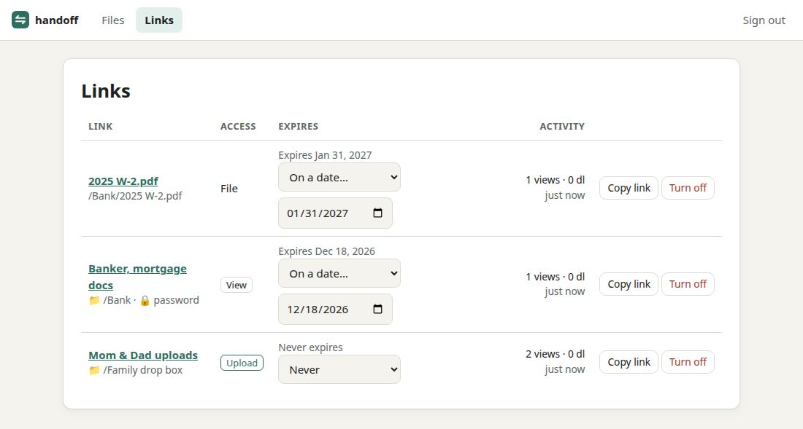
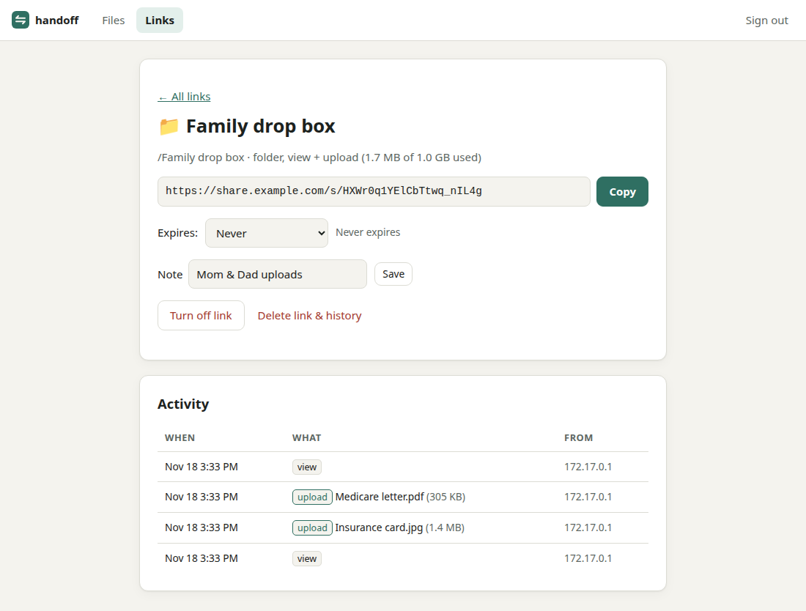

# handoff

<p>
  <a href="https://github.com/jasondostal/handoff/actions/workflows/build.yml"></a>
  <a href="https://github.com/jasondostal/handoff/releases"></a>
  
</p>

A lightweight, self-hosted file sharing app. Send someone a link to a file or a folder.

- **Share a file.** They get a page with one Download button.
- **Share a folder, view only.** They can browse it and download files one at a time or as a zip.
- **Share a folder, with uploads.** They can also drop files in and make subfolders. They can't
  delete or replace anything. If they upload a file whose name is already taken, it's saved next
  to the old one as `name (2).ext`.

The people you send links to don't need an account or an app. The link is the permission. You
can give each link an expiry (a day, a week, a month, a date, or never) and change it whenever
you like. A link can also have a password, and upload links have a size allowance. Each link has
an activity log, so you can see whether it was opened and what came and went. Turn a link off
and it stops working right away.

<p>
  
  &nbsp;
  
  &nbsp;
  
</p>

## What you see

Everything lives in one folder on your server. The Files page is that folder: upload, make
folders, open or download what's there, and press **Share…** on anything to make a link to just
that item (and, for a folder, what's inside it).



Making a link takes four choices: what they can do, when it expires, an optional password, and a
note to yourself so you remember who it was for.



The Links page lists every link you've made. You can change an expiry right there, copy a link
again, or turn it off.



Each link has its own page with the full history.



Pages work without JavaScript. With it you also get drag and drop, an upload progress bar and copy
buttons. Light and dark themes follow your system.

## Run it

```yaml
services:
  handoff:
    image: ghcr.io/jasondostal/handoff:latest
    container_name: handoff
    restart: unless-stopped
    user: "1000:1000"
    ports:
      - "8080:8080"
    volumes:
      - ./shares:/shares   # the shared folder
      - ./data:/data       # the link database
    environment:
      - TZ=America/Chicago
      - HANDOFF_BASE_URL=https://share.example.com
      - HANDOFF_ADMIN_PASSWORD_HASH=${HANDOFF_ADMIN_PASSWORD_HASH}
    read_only: true
    tmpfs:
      - /tmp
    cap_drop:
      - ALL
    security_opt:
      - no-new-privileges:true
```

Make the two folders first (`mkdir shares data`) so they belong to you and not to root. Then make
the password hash:

```sh
docker run --rm -it ghcr.io/jasondostal/handoff hash-password
```

Put the hash in a `.env` file next to the compose file (`HANDOFF_ADMIN_PASSWORD_HASH='$2a$10$...'`,
single quotes so the `$` signs survive), then `docker compose up -d` and open
`https://share.example.com/admin/`.

Files you put in `./shares` by any other means (scp, Samba, a sync tool) show up too. Links can only
ever point inside that folder.

**Run it behind HTTPS.** A link is as good as a key, so it must never travel over plain HTTP. Any
TLS-terminating reverse proxy works. If yours buffers request bodies, turn that off for this site so
large uploads stream straight through (in nginx: `client_max_body_size 0;` and
`proxy_request_buffering off;`).

### Using your proxy's login instead of a password

If a single sign-on proxy (Authentik, Authelia, oauth2-proxy and so on) already guards your
services, let it guard `/admin` too, and leave the rest public so links work for everyone. Set
`HANDOFF_ADMIN_PROXY_SECRET` to a long random string and have the proxy send it on `/admin` only.
In nginx:

```nginx
location /admin {
    # ...your SSO auth_request lines...
    proxy_set_header X-Proxy-Auth "the-same-long-random-string";
    proxy_pass http://handoff:8080;
}

location / {
    proxy_set_header X-Proxy-Auth "";   # never let a visitor supply it
    proxy_pass http://handoff:8080;
}
```

You can use this and the password at the same time, or just one. With only the proxy secret set,
the admin pages can't be reached any other way.

## Configuration

| Variable | Default | |
|---|---|---|
| `HANDOFF_BASE_URL` | (required) | The public address links are built on, e.g. `https://share.example.com` |
| `HANDOFF_ADMIN_PASSWORD_HASH` | | bcrypt hash that turns on the built-in admin sign-in. Make one with `handoff hash-password` |
| `HANDOFF_ADMIN_PASSWORD` | | Plain-text password instead of a hash, for trying it out |
| `HANDOFF_ADMIN_PROXY_SECRET` | | See [Using your proxy's login](#using-your-proxys-login-instead-of-a-password) |
| `HANDOFF_TRUST_PROXY` | `false` | Take the visitor's IP for the activity log from `X-Real-IP` / `X-Forwarded-For`. Only turn on behind a proxy that sets them |
| `HANDOFF_DEFAULT_UPLOAD_MB` | `1024` | The upload allowance preselected for new upload links |
| `HANDOFF_OWNER` | | Your name, for the expired-link page: "Ask Sam for a new link" |
| `HANDOFF_ROOT` | `/shares` | The shared folder |
| `HANDOFF_DATA` | `/data` | Where `handoff.db` lives |
| `HANDOFF_LISTEN` | `:8080` | |

You need at least one of the password or the proxy secret, or nobody could make links.

## How it keeps things safe

This is a public web page that hands out files from your server, so it's built defensively. The
short version: a link can reach exactly what you shared and nothing else, upload links can only add
files, and nothing anyone uploads can run in a browser on your domain.

- **Links can't be guessed.** Each one carries 128 random bits. That also means whoever has a link
  has the access, so treat links like passwords. For anything sensitive, add a password and send it
  some other way (a text or a phone call).
- **No wandering outside the share.** Every file operation goes through Go's `os.Root`, which the
  operating system enforces: nothing that resolves outside the shared folder can be opened, symlinks
  included. On top of that, paths containing `..` or hidden names are refused before they get that
  far. Dotfiles are never listed, served or zipped.
- **Uploaded files never run.** Downloads are sent as attachments with `nosniff` and a
  `Content-Security-Policy: sandbox`, and anything that could carry script (HTML, SVG and the like)
  is sent as plain bytes. In the admin pages you can open PDFs, pictures, text, audio and video in
  the browser; everything else still only downloads.
- **Upload links only add.** Files are written to a temporary name and then linked into place,
  which fails instead of replacing anything that's already there. The upload allowance is checked
  while the file streams in and claimed atomically, so two uploads at once can't go over it.
- **Passwords** on links are stored as bcrypt hashes. Ten wrong tries in 15 minutes locks the link
  for a while. Changing a link's password signs out everyone who had unlocked it.
- **Forged form posts are refused** (Go's `http.CrossOriginProtection`), and cookies are
  `SameSite=Strict`, `HttpOnly`, and `Secure` over HTTPS.
- Every page is sent with `no-store`, `noindex`, `Referrer-Policy: same-origin`, a strict CSP, and
  `frame-ancestors 'none'`, so links don't leak into other sites' logs or search engines.

Found a hole? See [SECURITY.md](SECURITY.md).

### What it doesn't do

No encryption at rest (put the shared folder on an encrypted disk), no virus scanning, no resumable
uploads for multi-gigabyte files over shaky connections, and no accounts for the people you share
with. Renaming and moving files is done on the server for now, not in the app. Your reverse proxy's
access log will contain full link URLs, so keep that log as private as the links.

## Develop

It's one Go program with SQLite (pure Go, no cgo) and plain HTML templates, no JavaScript framework
and no build step for the front end.

```sh
go test ./...            # or ./dev go test ./... to use Go inside Docker
docker build -t handoff .
```

## License

MIT
